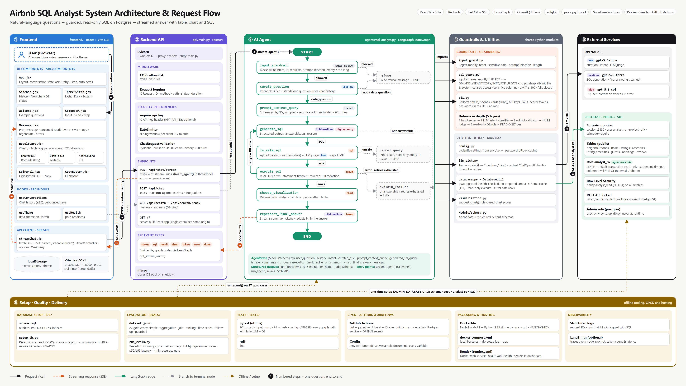
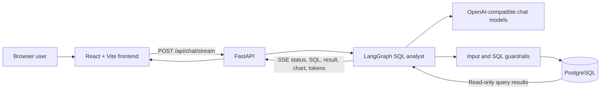

# Airbnb SQL Analyst

An AI-powered analytics application that turns natural-language questions about Airbnb-style listing and booking data into guarded PostgreSQL queries. It combines a React chat interface, a FastAPI service, and a LangGraph agent that validates and executes read-only SQL before returning a concise answer with a table or visualization.

The included database is populated with deterministic **synthetic sample data**. It is intended for development, demonstration, and evaluation; it is not Airbnb's production data.

## Contents

- [Introduction](#introduction)
- [Features](#features)
- [Architecture](#architecture)
- [AI agent architecture](#ai-agent-architecture)
- [Frontend](#frontend)
- [Backend and API](#backend-and-api)
- [Database and data model](#database-and-data-model)
- [Technology stack](#technology-stack)
- [Project structure](#project-structure)
- [Run with Docker](#run-with-docker-recommended)
- [Run locally for development](#run-locally-for-development)
- [Configuration](#configuration)
- [Testing and evaluation](#testing-and-evaluation)
- [Deployment notes](#deployment-notes)
- [Troubleshooting](#troubleshooting)
- [Future enhancements](#future-enhancements)
- [Author](#author)

## Introduction

Airbnb SQL Analyst is a read-only analytics assistant for asking questions such as:

- “What is the average nightly price by room type?”
- “Which cities have the most listings?”
- “How have bookings changed over time?”
- “What about Austin?” (as a follow-up to a previous question)

The application discovers the database schema at runtime, asks an LLM to draft a query, applies deterministic safety checks, and then executes the query using a restricted database role. The result is shown in the browser alongside the generated SQL, a data table or chart when appropriate, and a natural-language summary.

## Features

- Natural-language-to-PostgreSQL analytics with streaming progress and answer tokens.
- Interactive React chat UI with conversation history, retry, stop-generation, theme selection, charts, and tabular results.
- Follow-up questions resolved using recent conversation context.
- Deterministic synthetic Airbnb-style dataset and repeatable database setup.
- Defense-in-depth protections: input checks, intent classification, SQL parsing and validation, optional LLM SQL review, database-level read-only permissions, statement timeouts, and output PII redaction.
- Configurable model tiers for classification, SQL generation, retries, and answer generation.
- Health and readiness endpoints, optional API-key authentication, and in-memory per-process rate limiting.
- Automated tests and an evaluation harness for query accuracy, guardrails, answer quality, and latency.

## Architecture



The diagram shows every component and the end-to-end flow of one question (numbered badges). The source is [`docs/architecture.html`](docs/architecture.html). To regenerate the PNG after editing it, run `uv run --no-project --with playwright python docs/render_architecture.py`.

Simplified view:



In the Docker deployment, FastAPI serves the built frontend and the API from **one origin**, normally `http://localhost:8000`. During frontend development, Vite serves the UI at `http://localhost:5173` and proxies `/api` requests to FastAPI.

The backend is stateless between requests. The browser stores conversation history and theme preferences in local storage; only recent turns are sent with a chat request.

## AI agent architecture

The agent is implemented as a compiled LangGraph state graph in [`agents/sql_analyst.py`](agents/sql_analyst.py). At a high level, each analytics request follows this path:

1. **Input guard:** block clearly unsafe or out-of-scope requests before spending tokens.
2. **Curation and intent classification:** use a structured LLM response to classify the request, resolve follow-ups, and produce a standalone question. Non-data requests are refused.
3. **Schema context:** load table and column details, relationships, and a small number of sample rows. Sensitive columns are omitted; schema details are cached.
4. **SQL generation:** generate one read-only `SELECT` query. Use the configured medium-tier model initially and the high-tier model when correcting a failed query.
5. **SQL validation:** parse and validate the query deterministically. If enabled, an LLM judge provides an additional veto-only check; it cannot override a deterministic rejection.
6. **Read-only execution:** run the query with the restricted database role, a read-only transaction, a statement timeout, and a row cap. Database errors can trigger bounded SQL self-correction.
7. **Result protection and presentation:** redact PII, select a suitable visualization, and stream a concise answer based on the returned data.

The model is instructed to use only schema-provided columns, avoid `SELECT *`, and return a single read-only query. Deterministic SQL validation and database permissions remain authoritative safety layers; LLM instructions alone are not treated as a security boundary.

Model tiers can be configured independently:

| Tier | Typical use |
|---|---|
| Low | Request curation, intent classification, optional SQL judge |
| Medium | SQL generation and final-answer generation |
| High | SQL correction after an execution error |

## Frontend

The frontend is a React single-page application built with Vite. It includes:

- Chat composer with streaming response, stop, and retry interactions.
- Conversation sidebar and browser-local history (up to 30 conversations).
- Light, dark, and system theme preferences.
- Streaming progress indicators, rendered assistant messages, and copy controls.
- SQL display, result tables, metric cards, and charts selected from result shape and question intent.
- A readiness indicator that polls the backend and database readiness endpoint.

Key frontend files include [`frontend/src/App.jsx`](frontend/src/App.jsx), [`frontend/src/api/streamChat.js`](frontend/src/api/streamChat.js), and [`frontend/src/components/`](frontend/src/components).

## Backend and API

The backend is a FastAPI application in [`api/main.py`](api/main.py). Interactive API documentation is available at `/docs` when the service is running.

### Endpoint overview

| Method | Path | Purpose | Authentication |
|---|---|---|---|
| `GET` | `/api/health` | Liveness check; returns `{"status":"ok"}` when the API process responds. | None |
| `GET` | `/api/health/ready` | Readiness check; verifies the database connection. Returns `503` if the database cannot be reached. | None |
| `POST` | `/api/chat/stream` | Main chat endpoint. Streams agent events using Server-Sent Events (SSE). | Optional `X-API-Key`; rate-limited |
| `POST` | `/api/chat` | Non-streaming chat endpoint for scripts and integrations. | Optional `X-API-Key`; rate-limited |
| `GET` | `/` and other frontend paths | Serves the built single-page frontend when `frontend/dist` exists. | None |

When `APP_API_KEY` is set, both chat endpoints require the matching `X-API-Key` header. The default rate limit is 20 requests per minute per client IP and is held in process memory; it is not shared across multiple workers or instances.

### Chat request

Both chat endpoints accept a JSON body in this shape:

```json
{
  "question": "What is the average nightly price by room type?",
  "history": [
    {"role": "user", "content": "Compare listing prices by city"},
    {"role": "assistant", "content": "Here is the comparison..."}
  ]
}
```

`question` must be non-empty and is limited by `MAX_QUESTION_CHARS` (default: 1,000). `history` is optional, allows up to 20 turns per request, and each turn's content is limited to 4,000 characters. The UI sends up to six recent turns by default.

### Streaming response events

`POST /api/chat/stream` returns `text/event-stream`. Each event contains a JSON object in its `data` field:

| Event `type` | Important fields | Meaning |
|---|---|---|
| `status` | `step`, `message` | Agent progress update |
| `sql` | `sql` | Validated query that will be run |
| `result` | `columns`, `rows`, `row_count`, `truncated` | Query result |
| `chart` | `chart` | Visualization specification |
| `token` | `content` | A streamed answer fragment |
| `error` | `message` | Safe, user-facing error |
| `done` | `intent`, `sql`, `answer`, `attempts`, `latency_ms` | Completion metadata and final answer |

Example:

```text
event: status
data: {"type":"status","step":"generate_sql","message":"Writing the SQL query"}

event: token
data: {"type":"token","content":"The average price is ..."}
```

### Non-streaming response

`POST /api/chat` returns a JSON object with `answer`, `intent`, `sql`, `result`, and `chart`. The `sql` field is populated only when the generated query passed the safety check.

## Database and data model

PostgreSQL 14 or newer is supported by the schema. The included setup script creates eight related tables:

| Table | Purpose |
|---|---|
| `neighbourhoods` | Neighborhood and city lookup |
| `hosts` | Host attributes; email and phone are sensitive |
| `listings` | Property, location, room, capacity, price, and availability details |
| `amenities` | Amenity lookup |
| `listing_amenities` | Many-to-many listing/amenity relationship |
| `guests` | Guest attributes; email is sensitive |
| `bookings` | Booking dates, guests, price, payment method, and status |
| `reviews` | Ratings and review comments |

[`db/setup_db.py`](db/setup_db.py) creates the schema, seeds deterministic synthetic data if the tables are empty, and creates/configures the analyst read-only role. The default seed includes 2,000 listings, 400 hosts, 3,000 guests, 15,000 bookings, and generated reviews across six US cities.

The application should connect using the read-only analyst role, not the owner account. The setup script uses `ADMIN_DATABASE_URL` only for schema and role setup. Do not configure the running API with the admin connection string.

## Technology stack

| Area | Technologies |
|---|---|
| Frontend | React 19, Vite, React Markdown, Recharts, Lucide React |
| Backend | Python 3.13, FastAPI, Uvicorn, Pydantic Settings |
| Agent orchestration | LangGraph, LangChain OpenAI integration |
| Database | PostgreSQL 14+, Psycopg 3, Psycopg connection pool |
| SQL safety | SQLGlot, deterministic input and SQL guardrails |
| Local infrastructure | Docker, Docker Compose |
| Python tooling | uv, pytest, Ruff |
| UI tooling | npm |

## Project structure

```text
.
├── agents/
│   └── sql_analyst.py        # LangGraph workflow and agent nodes
├── api/
│   └── main.py               # FastAPI routes, SSE, auth, health checks, SPA hosting
├── db/
│   ├── schema.sql            # PostgreSQL tables, constraints, and indexes
│   └── setup_db.py           # Schema setup, synthetic seed data, read-only role
├── docs/                     # Supporting project documentation and assets
├── evals/
│   ├── dataset.jsonl         # Natural-language evaluation cases
│   ├── run_evals.py          # Offline evaluation runner
│   └── results/              # Saved evaluation output
├── frontend/
│   ├── src/
│   │   ├── api/              # Browser-to-API streaming client
│   │   ├── components/       # Chat, charts, tables, and UI components
│   │   └── hooks/            # Conversation, theme, and health state
│   ├── index.html
│   └── vite.config.js        # Development server and API proxy
├── guardrails/
│   ├── input_guard.py        # Pre-LLM request checks
│   ├── pii.py                # Result and answer redaction
│   └── sql_guard.py          # Deterministic SQL validation
├── Models/
│   └── schema.py             # Agent state and structured LLM output models
├── tests/                    # Backend, guardrail, and visualization tests
├── utils/
│   ├── config.py             # Environment-based application settings
│   ├── database.py           # Read-only DB pool, query execution, schema context
│   ├── llm_pick.py           # Cached model-tier selection
│   └── visualization.py      # Data-driven chart selection
├── Dockerfile                # Multi-stage frontend build and Python runtime
├── docker-compose.yml        # PostgreSQL, database setup, and application services
├── main.py                   # Local API entry point
├── pyproject.toml            # Python dependencies and tooling
└── .env.example              # Documented environment variable template
```

## Run with Docker (recommended)

### Prerequisites

- Docker Desktop installed and running.
- An OpenAI API key for agent requests.

### Start the app

From the project root in PowerShell:

```powershell
Copy-Item .env.example .env
```

Edit `.env` and set `OPENAI_API_KEY` to a valid key. Then start the stack:

```powershell
docker compose up --build
```

Compose starts PostgreSQL, runs the one-shot `db-setup` service to create and seed the database, then starts the API and UI. Once the app is up, open:

**http://localhost:8000**

The frontend is served by FastAPI from the same address; a separate frontend command is not needed for the Docker setup. The UI's backend readiness indicator should show online when both the API and database are ready.

To run in the background:

```powershell
docker compose up --build -d
docker compose ps
docker compose logs -f app
```

Stop the stack with `Ctrl+C` in the foreground, or:

```powershell
docker compose down
```

The database is stored in the `pgdata` named volume and remains across ordinary container restarts. To remove the database volume and its data, run `docker compose down -v` only when you intentionally want a clean database.

**Port note:** the API container listens on port `8000`, mapped to `http://localhost:8000`. Do not set `PORT=5432` in `.env`; `5432` is PostgreSQL's port. If you already have a `PORT` entry set to `5432`, change it to `8000` or remove it, then recreate the app:

```powershell
docker compose up -d --force-recreate app
```

### Use a cloud database with the Docker app

Configure the database setup and application connection variables in `.env` for your PostgreSQL provider, then build and run the app image against that database. For provider-specific connection-string requirements (including SSL and Supabase pooler usernames), consult the provider's documentation. Keep the admin URL restricted to setup; the app must use the read-only role URL.

## Run locally for development

### Prerequisites

- Python 3.13 and [uv](https://docs.astral.sh/uv/).
- Node.js 22 and npm.
- Docker Desktop for a local PostgreSQL instance, or access to a compatible PostgreSQL database.
- An OpenAI API key.

### Install and configure

From the repository root:

```powershell
uv sync
Copy-Item .env.example .env
```

Set `OPENAI_API_KEY` in `.env`. For the local Docker database, ensure the admin password and read-only role password in `.env` match the values used by Compose (`POSTGRES_PASSWORD` and `ANALYST_RO_PASSWORD`).

Start just the local database:

```powershell
docker compose up -d db
```

Create the schema, seed data, and read-only role:

```powershell
uv run python db/setup_db.py
```

Start the backend in one terminal:

```powershell
$env:RELOAD = "true"
uv run python main.py
```

Start the frontend in a second terminal:

```powershell
Set-Location frontend
npm install
npm run dev
```

Open **http://localhost:5173**. Vite proxies `/api` requests to `http://localhost:8000`. The FastAPI backend is also available at **http://localhost:8000**, with interactive API docs at **http://localhost:8000/docs**.

To run the agent directly from the command line:

```powershell
uv run python agents/sql_analyst.py "What is the average price per room type?"
```

## Configuration

Settings are loaded from environment variables and `.env` by [`utils/config.py`](utils/config.py). Common settings:

| Variable | Purpose |
|---|---|
| `OPENAI_API_KEY` | Credentials for the configured chat models |
| `LLM_MODEL_LOW` | Model for curation, classification, and optional SQL judge |
| `LLM_MODEL_MEDIUM` | Model for SQL generation and final answer |
| `LLM_MODEL_HIGH` | Model used for SQL self-correction |
| `LLM_TIMEOUT_SECONDS` | LLM request timeout |
| `ENABLE_LLM_JUDGE` | Enable the additional LLM SQL safety review |
| `DATABASE_URL` | PostgreSQL connection string for the **read-only** analyst role |
| `ADMIN_DATABASE_URL` | Owner connection string used only by `db/setup_db.py` |
| `ANALYST_RO_USER` | Name of the read-only role created during database setup |
| `ANALYST_RO_PASSWORD` | Password assigned to the read-only role |
| `POSTGRES_PASSWORD` | Local Compose PostgreSQL superuser password |
| `DB_SCHEMA` | Database schema name (default: `public`) |
| `DB_STATEMENT_TIMEOUT_MS` | Database statement timeout in milliseconds |
| `DEFAULT_ROW_LIMIT` / `MAX_ROW_LIMIT` | Default and maximum result size |
| `MAX_SQL_RETRIES` | Maximum self-correction retries after SQL execution errors |
| `SENSITIVE_COLUMNS` | Comma-separated column names hidden or rejected by guardrails |
| `APP_API_KEY` | Optional API key required by chat endpoints; unset/empty disables auth |
| `RATE_LIMIT_PER_MINUTE` | Per-process chat request limit |
| `CORS_ORIGINS` | Comma-separated allowed browser origins |
| `PORT` | API listener port; use `8000` for the standard Docker mapping |
| `VITE_API_URL` | Optional API base URL for a separately hosted frontend |
| `VITE_API_KEY` | Optional API key included by the frontend when calling the API |

See [`.env.example`](.env.example) for the complete list of settings and examples. Keep `.env` private and never commit API keys, database credentials, or production secrets. Database passwords containing URL-reserved characters must be URL-encoded in connection strings; the setup/application configuration also normalizes common encoded password cases.

## Testing and evaluation

Run the backend test suite:

```powershell
uv run pytest
```

Run Ruff checks:

```powershell
uv run ruff check .
```

Build the frontend:

```powershell
Set-Location frontend
npm run build
```

Run the evaluation harness after configuring a reachable database and LLM credentials:

```powershell
uv run python evals/run_evals.py
```

Optional evaluation flags:

```powershell
uv run python evals/run_evals.py --category join
uv run python evals/run_evals.py --judge
uv run python evals/run_evals.py --min-accuracy 0.8
```

The evaluation runner compares query results with expected results and can report guardrail behavior, answer quality, latency, and correction attempts. LLM-backed tests and evaluations may incur API usage.

## Deployment notes

- The Docker image uses a multi-stage build: Vite builds the frontend, then FastAPI serves the static UI alongside the API.
- The included `render.yaml` describes a Render Docker web service. Configure `OPENAI_API_KEY`, a read-only `DATABASE_URL`, `APP_API_KEY`, and allowed `CORS_ORIGINS` as deployment secrets/settings.
- Hosted PostgreSQL providers such as Neon or Supabase can be used. Configure SSL as required by the provider; Supabase users should follow the provider's current pooler connection-string guidance.
- Create the schema and read-only role with `db/setup_db.py` using an admin connection from a trusted environment. Do not expose `ADMIN_DATABASE_URL` to the running web service.
- For production, use strong unique credentials, enable API authentication, restrict origins, and place the app behind HTTPS and any required network controls.
- The built-in rate limiter and connection pool are process-local. For multiple replicas, use shared rate limiting and verify pool sizing against the database provider's connection limits.

## Troubleshooting

| Symptom | Checks and actions |
|---|---|
| Browser cannot open `http://localhost:8000` | Run `docker compose ps` and `docker compose logs --tail 100 app`. Confirm the app is running and port `8000` is published. |
| App container is `unhealthy` and the health check reports connection refused | Check `.env` for `PORT=5432`. The API must listen on container port `8000`; remove the incorrect `PORT` entry or set it to `8000`, then run `docker compose up -d --force-recreate app`. |
| `docker compose up` fails in `db-setup` | Check database health and that `POSTGRES_PASSWORD`/`ANALYST_RO_PASSWORD` values are consistent. Inspect with `docker compose logs db-setup`. |
| UI loads but reports backend offline | Check that the API and database are running; test `http://localhost:8000/api/health/ready`. |
| Chat request reports missing credentials | Set `OPENAI_API_KEY` in `.env` and restart/recreate the app container so it receives the updated environment. |
| Chat request returns `401` | If `APP_API_KEY` is set, ensure the frontend `VITE_API_KEY` or request `X-API-Key` matches. |
| Database connection or permission error | Verify `DATABASE_URL` uses the read-only analyst role, confirm the role password and host, and rerun database setup with the admin URL if grants or schema are missing. |
| Local frontend cannot reach the backend | Ensure FastAPI is listening on `8000`; the Vite proxy defaults to `http://localhost:8000` and can be changed with `VITE_PROXY_TARGET`. |
| Responses appear buffered instead of streaming | Check any reverse proxy for SSE buffering. The API disables proxy buffering with `X-Accel-Buffering: no`; the proxy may also need streaming/buffering configuration. |

## Future enhancements

These are possible next steps, not claims about currently implemented features:

- Add authentication and authorization integrated with an identity provider, with user- or tenant-scoped database access.
- Persist conversations in a backend store and support sharing, exports, and audit history.
- Introduce shared distributed rate limiting and centralized observability for multi-instance deployments.
- Add query-cost estimation, workload-aware limits, and additional database/provider adapters.
- Expand evaluation coverage with regression dashboards, production-quality traces, and larger representative datasets.
- Improve accessibility, localization, and automated end-to-end browser testing.
- Add configurable chart controls and downloadable CSV or spreadsheet exports.
- Add schema change/version management and automated database migration workflows.

## Author

**Ankit Bisen**
